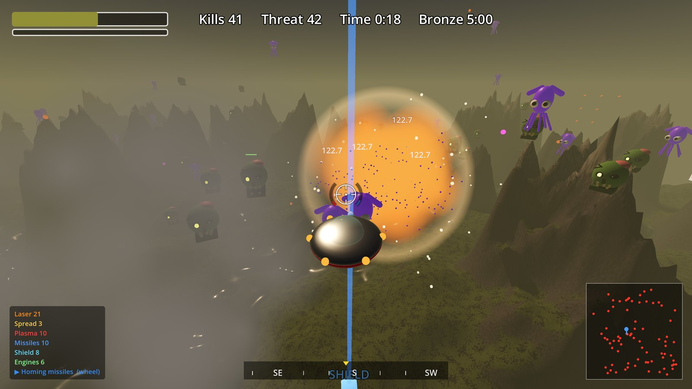
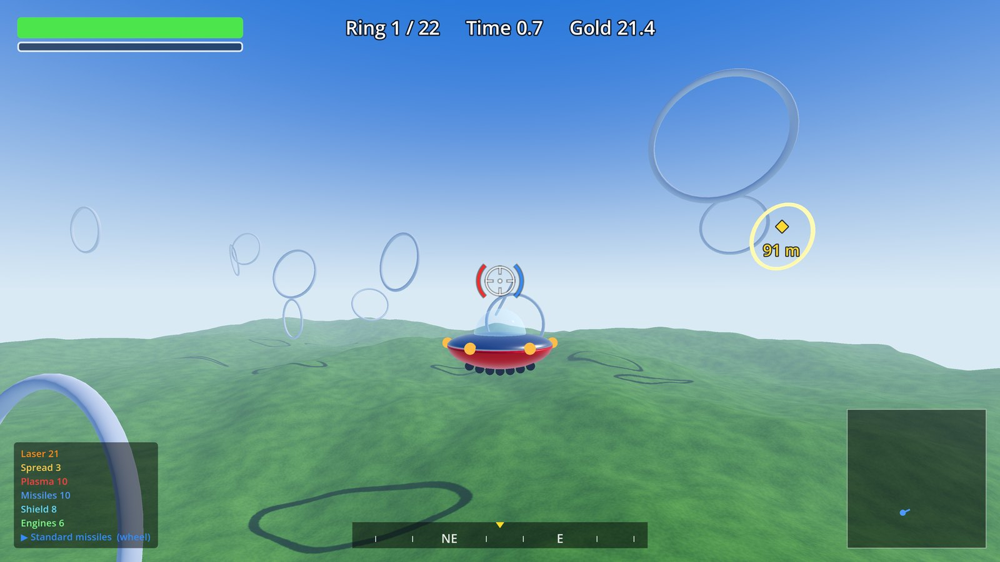
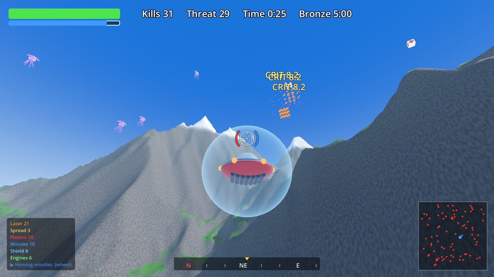
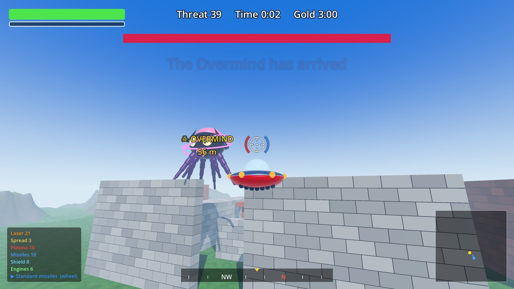
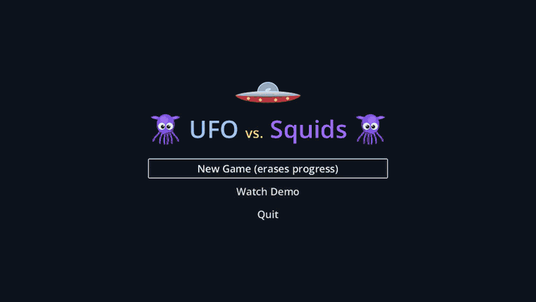

# UFO vs. Squids

A third-person arcade shooter made with [Godot 4.7](https://godotengine.org). Pilot a flying saucer through five missions against swarms of squids and worse.

  
  
  
  

## Features

- Five missions with bronze, silver and gold medals
- Randomly generated terrain
- Three weapons, including charged plasma and switchable missiles
- Skill tree with 20 skills
- Flight model with inertia and drag
- Progress is kept when you die, so replaying earlier missions pays off
- Autopilot demo on the title screen

## Progression

Destroy rare enemies to earn skill points, then spend them in the skill tree. All upgrades come from the tree. A medal unlocks the next mission.

## Controls

| Input | Action |
|---|---|
| Mouse | Look and aim |
| `W` `A` `S` `D` | Fly |
| `Space` / `Ctrl` | Up / down |
| `Shift` | Boost |
| Left mouse | Laser |
| Right mouse | Missile |
| Mouse wheel | Switch missile type |
| Middle mouse | Hold to charge plasma, release to fire, press again to detonate |
| `T` | Skill tree |
| `Esc` | Pause menu |
| `F3` | FPS display |

## Running

Open `project.godot` in Godot 4.7 and press F5.

## License

[MIT](LICENSE)
